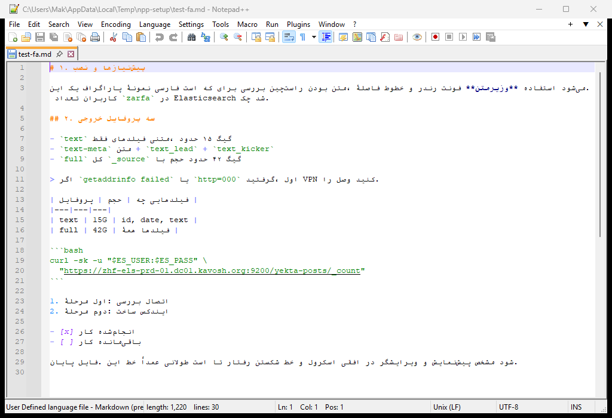
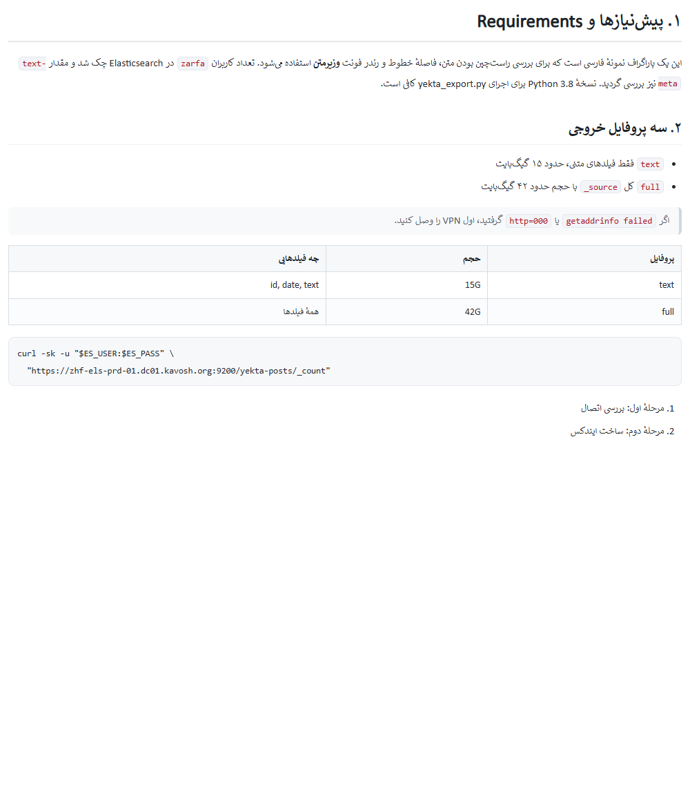
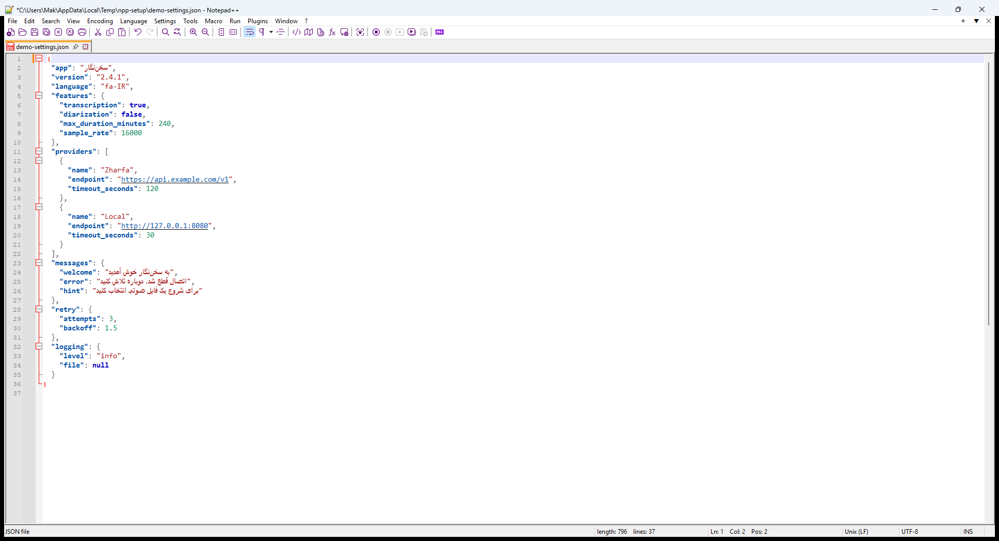

# PersianKit for Notepad++

RTL (right-to-left) editing and the **Vazirmatn** font for Persian documents in Notepad++ — as a real plugin, plus an installer kit that also makes Markdown *previews* look right.

```
Plugins ▸ PersianKit ▸ Persian mode (RTL + Vazirmatn)      Alt+Shift+R  (toggle RTL)
```



---

## What it does

| | |
|---|---|
| **RTL editing** | Flips Scintilla's bidirectional mode (`SCI_SETBIDIRECTIONAL`), so Persian lines are laid out right-to-left: digits, punctuation and Latin fragments stay in the correct place instead of jumping to the wrong end. |
| **Vazirmatn** | Applies the font to every style of the current document (syntax colours are preserved). |
| **Auto Persian for `.md` / `.txt`** | When you switch to a Markdown/plain-text file, the plugin applies Vazirmatn + RTL automatically (remembered in an ini file). |
| **Installer kit** | Optional, for the *preview*: RTL + Vazirmatn CSS for the third-party **Markdown Panel** plugin, better JSON colours, word wrap, DirectWrite off. |

## Install

### A. Quick install (no compiler needed)

1. Open the [latest release](https://github.com/ahmadkhanloo/npp-persian-kit/releases/latest).
2. Download **`PersianKit_x64.zip`** (or `PersianKit_x86.zip` for 32-bit Notepad++).
3. **Close Notepad++**, then copy the `PersianKit` folder into
   `C:\Program Files\Notepad++\plugins\` (needs administrator – Explorer will ask).
   Portable Notepad++? copy it into `<portable folder>\plugins\`.
4. Start Notepad++ → `Plugins ▸ PersianKit`.

### B. Build and install from source

Notepad++ only loads plugins from its own folder, so this step needs administrator rights:

```powershell
build\build.bat                    # x64  (needs Visual Studio Build Tools, C++)
build\build-x86.bat                # x86  (optional, only for 32-bit Notepad++)
powershell -ExecutionPolicy Bypass -File build\install-plugin.ps1
```

No compiler? Every push is built by GitHub Actions — download the `PersianKit-x64` artifact and copy `PersianKit.dll` into
`C:\Program Files\Notepad++\plugins\PersianKit\`.

> **Plugin Admin:** submitted to the official list in
> [notepad-plus-plus/nppPluginList#1272](https://github.com/notepad-plus-plus/nppPluginList/pull/1272) —
> once it is merged and the list ships, `Plugins ▸ Plugins Admin ▸ PersianKit` will install it in one click.

Requirements for RTL:
1. **DirectWrite off** — `Settings ▸ Preferences ▸ MISC ▸` uncheck *DirectWrite (Direct2D)*, restart Notepad++.
   (Scintilla's bidi support is not available in DirectWrite mode; the plugin warns you if it is still on.)
2. **UTF-8 document** — `Encoding ▸ Convert to UTF-8` (the plugin warns, it does not convert silently).
3. The **Vazirmatn** font installed (see below).

### B. Kit (plugin + preview styling + font, no admin rights)

`kit\install.cmd` — installs the font for the current user, patches `config.xml`/`stylers.xml`, sets the Markdown UDL font,
and copies the RTL stylesheet for **Markdown Panel** into `plugins\config`. Every edited file is backed up as `*.bak-<date>`.
Details: [`kit/README-fa.md`](kit/README-fa.md) (Persian).

### Font

Vazirmatn by **Saber Rastikerdar** — <https://github.com/rastikerdar/vazirmatn> (OFL 1.1).
The kit installs it; for the plugin alone install it manually or run `kit\install.cmd`.

## Commands

| Command | Default shortcut |
|---|---|
| Persian mode (RTL + Vazirmatn) | – |
| Toggle RTL / LTR | `Alt+Shift+R` |
| Apply Vazirmatn font | – |
| Auto Persian for `.md`/`.txt` (checkable) | – |
| JSON: format (2 spaces) | – |
| JSON: fold all | – |
| About | – |

All of them appear in `Settings ▸ Shortcut Mapper ▸ Plugin commands`, so you can bind your own keys.

Settings file: `%APPDATA%\Notepad++\plugins\config\NppPersianKit.ini`

```ini
[PersianKit]
AutoPersianForMarkdown=1   ; apply automatically for md/txt
TurnRtlOn=1                ; Persian mode also turns RTL on
FontFace=Vazirmatn
FontSize=12
JsonIndentWidth=2          ; spaces per JSON level (ignored when the doc uses tabs)
```

## Markdown reading — plugin or kit?

PersianKit is a **Persianizer**: it changes direction and font of the *editor*. It does **not** render Markdown
(it contains no HTML/WebView renderer and no Markdown parser).

Markdown *reading* comes from the third-party **Markdown Panel** plugin (`Plugins Admin ▸ Markdown Panel`).
The kit’s stylesheet is what makes that preview RTL with Vazirmatn:



JSON files get a cleaner palette and folding out of the box — see the next section.

So:

* want only Persian *editing*? → this plugin (tiny, no dependencies)
* want beautiful Persian *preview/reading*? → plugin **+** Markdown Panel **+** `kit\css\persian-markdown.css`

---

## JSON: clean colours, monospace, folding

The kit patches **only** the `json` lexer block of `stylers.xml` (everything else — theme, other languages — stays
untouched). The original block is kept next to it as `stylers.xml.bak-<date>`.



| Token | Colour | Note |
|---|---|---|
| property name (`"key":`) | `#0451A5` **bold** | keys pop out, easy to scan |
| string value | `#A31515` | old `#800000` was muddy |
| number | `#098658` | old `#FF8000` looked like an error |
| `true` / `false` / `null` | `#0000C0` **bold** | one colour for all literals |
| escape sequence | `#D12F1B` | |
| URI / IRI | `#0451A5` | |
| invalid token | white on `#E45649` | visible instead of a pale orange |
| comments (`//`, `/* */`) | `#008000` *italic* | |

Plus:

* font **Consolas 11** for the whole JSON lexer (aligned columns, no proportional wobble)
* **folding** is available: the fold margin shows `+`/`-`; `View ▸ Fold All` collapses the whole document
* the status bar identifies the language as `JSON file`
* Persian strings inside the JSON are shaped by the system fallback — the colour/indent work is what makes the
  structure readable

**Revert / customise**

```text
%APPDATA%\Notepad++\stylers.xml            <- patched
%APPDATA%\Notepad++\stylers.xml.bak-<date> <- original, copy back to undo
```

or change the colours interactively: `Settings ▸ Style Configurator ▸ Language: json`.

**Need a tree view?** The plugin list has an official **JSON Tools** plugin
(`Plugins ▸ Plugins Admin ▸ "JSON Tools"`) for a clickable tree, reformatting, minify and schema validation.

**Formatting without extra plugins:** PersianKit ships two small JSON commands of its own —

* `Plugins ▸ PersianKit ▸ JSON: format (2 spaces)` — pretty-prints the whole document: **every nesting level shifts one
  step deeper**. UTF-8 safe (Persian string values are preserved), a single undo step, and if the text is not one valid
  JSON value the document is left untouched with a warning instead of a mangled buffer.
  * **Indentation step:** if the document is set to use tabs (`Settings ▸ Preferences ▸ Language ▸ Tab Settings`, or
    `View ▸ Show Symbol ▸ Show White Space` to verify) each level gets **one TAB**; otherwise it gets
    `JsonIndentWidth` spaces (default **2**, editable in `NppPersianKit.ini`).
* `Plugins ▸ PersianKit ▸ JSON: fold all` — collapses every foldable block (`SCI_FOLDALL`).

The beautifier is covered by an offline test: `build\test\run-test.bat` (see [Build](#build)).

## Build

```bat
build\build.bat
:: -> dist\PersianKit\PersianKit.dll
```

* x64, MSVC 2019/2022/2026 Build Tools, no external dependencies (only `user32.lib`, `advapi32.lib`).
* GitHub Actions: [`.github/workflows/build.yml`](.github/workflows/build.yml) builds every push; tagged builds (`v1.0.0`) also produce a release zip.

## How it works

* `setInfo()` loads the ini, `beNotified()` reacts to `NPPN_READY` / `NPPN_BUFFERACTIVATED`.
* `NPPM_GETCURRENTSCINTILLA` → current Scintilla handle; `NPPM_GETEXTPART` → file extension.
* `SCI_STYLESETFONT`/`SCI_STYLESETSIZE` for styles `0..STYLE_MAX` (colours untouched).
* `SCI_SETBIDIRECTIONAL(SC_BIDIRECTIONAL_R2L)` for direction; a `config.xml` sniff detects DirectWrite and warns.
* No hooks, no global state outside `NppPersianKit.ini`.

## Licence

* Plugin source (`src/`, `build/`): **GNU GPL v3.0** — see [LICENSE](LICENSE). (Notepad++’s plugin interface is GPL as well.)
* Installer kit (scripts, CSS): GPL v3.0
* Bundled font: **SIL Open Font License 1.1** — [`kit/fonts/OFL.txt`](kit/fonts/OFL.txt)

Notepad++ is © Don Ho and contributors; this project is not affiliated with the Notepad++ project.
